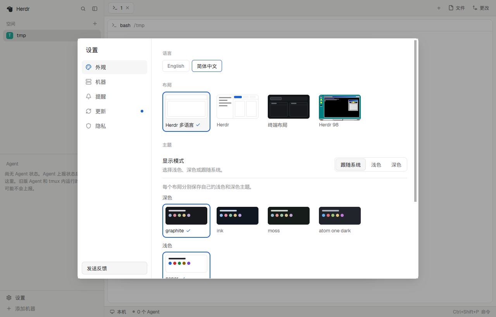

# herdr-i18n

[简体中文](README.md)

[Herdr's desktop app](https://github.com/herdrdev/herdr-app) is English-only and has no language setting. This repository provides one layout with a language menu, `herdr-i18n`: apart from the text, the window has the same structure, look and behavior as Herdr's own `main` layout, and changing language keeps your layout, theme and tabs.



| Language | Coverage | Herdr version |
|---|---|---|
| English | source text | v0.1.13 |
| Simplified Chinese | 100% | v0.1.13 |

## Install

Update Herdr to the version above (Settings › Updates) and open it at least once.

```sh
git clone https://github.com/Chlience/herdr-i18n && cd herdr-i18n
python3 tools/i18n.py install en --keys
herdr-app do layout.switch '{"name":"herdr-i18n"}'
```

Then change language in Settings › Look › Language, or search the palette for `language`. The panels reload at once, so what they hold only in memory, such as a folded list, can reset.

- **`en`** is the language to show after installing. Leave it out to keep the current one, or to get English on a new install.
- **`--keys`** adds a `layout:herdr-i18n` section to `keys.json`, so the Settings, palette, Keys and picker shortcuts open the translated screens. The section applies only while the layout shows, but Herdr then treats `keys.json` as yours and stops adding new default shortcuts to it. Without `--keys`, screens opened by clicking follow the language and screens opened by shortcut are in English.

`install` writes only the `i18n-*` mods and `layouts/herdr-i18n.json`. It stops rather than replace a file of the same name it didn't generate. It also removes an earlier per-language layout such as `zh-cn`.

You can also ask an agent in Herdr: have it read `~/.config/herdr-app/AGENTS.md`, then add `https://github.com/Chlience/herdr-i18n`. This way starts in English; pick a language in the menu afterwards.

**Update:** after Herdr updates, `git pull` and run `install` again. An older build usually keeps working but misses the new version's fixes and features.

**Uninstall:** switch to another layout with `layout.switch`, then delete `layouts/herdr-i18n.json`, `mods/i18n-*` and the `layout:herdr-i18n` section of `keys.json`.

## Why the language menu lives in a layout

Herdr rewrites its shipped mods on every start, and the app opens its own screens by fixed name, so their text can't be replaced from outside. Using copies of those mods in a layout is the only way that doesn't fight the update mechanism, so that layout carries the language menu.

A language setting that covers every layout and the app itself has to come from upstream. That request is [herdrdev/herdr-app#525](https://github.com/herdrdev/herdr-app/issues/525).

## Limits

- Only the `herdr-i18n` layout follows the language. Terminals, Herdr 98 and other layouts stay in English.
- What the app opens or draws by fixed name stays in English: close confirmations, the rename box, the peek bar, notifications, native menus and some errors.
- Screens the app opens by itself stay in English: Welcome on first start, What's new after an update, and Settings when opened from an update notice. The body of What's new comes from the release notes, also in English.
- The action column in Keys (such as `space select 1`) and some unnamed palette commands are built from command IDs, so a catalog can't translate them.
- Each build holds copies of Herdr's mods, so a new Herdr release needs a new build here to carry upstream's fixes.

## Add a language

You only need Python 3, with no packages to install. The tool downloads the herdr-app source pinned in `upstream.json`.

```sh
python3 tools/i18n.py new ja --name 日本語 --title "Herdr 多言語"
# translate the empty strings in locales/ja.json; empty ones show in English
python3 tools/i18n.py check ja -v       # coverage, stale entries and errors
python3 tools/i18n.py build             # rewrites mods/ and layouts/; the language joins the menu
python3 tools/i18n.py install ja --keys
```

A catalog has these parts:

- `name` is the language's name in the menu; `title` is the layout's name in the layout list.
- `literals`: plain strings, keyed by the English text.
- `templates`: template strings. You can reorder the `${...}` and translate the text inside them, but not change the code, or `check` fails. So a catalog is only data, and reviewing a pull request never means reviewing code.
- `per_file`: a different translation for one file, keyed like `help/main.js`. `null` keeps the English there. Words like `open` are ids in other files, so the template from `new` lists them only here; don't move them to `literals`.

Strings the code compares (as in `action === "open"`) are never translated, and `build` lists them.

`source/strings.json` lists every text to translate, with its file and line. In your pull request, commit the generated files too, and look at the result in Herdr: longer text can break a layout.

If the tool misses a text or picks up something that isn't one, edit `source/rules.json`: `ignore` drops strings people don't read, `include` adds ones it missed.

## Move to a new Herdr release

```sh
python3 tools/i18n.py upgrade v0.1.14   # pins it, and lists changed texts and each language's coverage
# add translations; build fails outright if a patch in upstream.json stopped matching
python3 tools/i18n.py build
python3 -m unittest discover -s tools   # includes a test that each language changes only text
```

Also review `screens` in `upstream.json` (each screen's size in upstream's `src/window.rs`) and the mod lists, then click through the language menu. GitHub Actions checks for a new release daily and opens an issue with a report of what changed.

## How it works

Each `mods/i18n-*` has one folder per language, holding that language's copy of the mod. Its `main.js` is one line naming the folder to show. The language menu rewrites that line, Herdr reloads the mod, and the language stays until you change it again.

## License

Apache-2.0, as herdr-app. The files in `mods/` are modified herdr-app files; the first line of each names its source.
