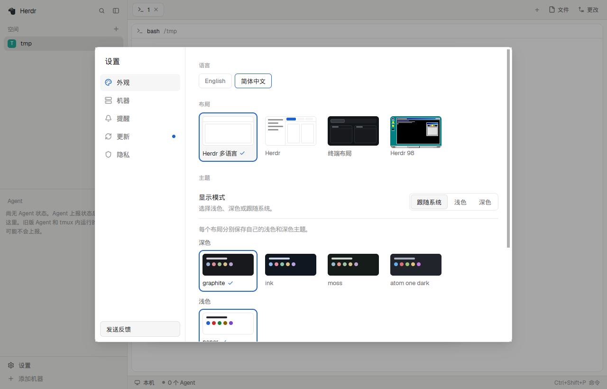

# herdr-i18n

[English](README.en.md)

[Herdr 桌面版](https://github.com/herdrdev/herdr-app)目前只有英文界面，也没有语言设置。本仓库提供一个带语言菜单的布局 `herdr-i18n`：除文字外，窗口的结构、外观和行为都与 Herdr 自带的 `main` 布局相同；切换语言时不用换布局，主题和标签页也保持不变。



| 语言 | 覆盖率 | 对应 Herdr 版本 |
|---|---|---|
| English | 原文 | v0.1.13 |
| 简体中文 | 100% | v0.1.13 |

## 安装

需要先把 Herdr 更新到上表对应的版本（设置 › 更新），并至少打开过一次。

```sh
git clone https://github.com/Chlience/herdr-i18n && cd herdr-i18n
python3 tools/i18n.py install zh-CN --keys
herdr-app do layout.switch '{"name":"herdr-i18n"}'
```

安装后，可以在「设置 › 外观 › 语言」中切换语言，也可以在命令面板中搜索 `language` 或 `语言`。各面板会随即重新加载，只保存在内存中的状态（如列表的折叠）可能复位。

- **`zh-CN`** 是安装后显示的语言。省略时，已安装的保持当前语言，新安装的显示英文。
- **`--keys`** 会在 `keys.json` 中添加 `layout:herdr-i18n` 一节，让设置、命令面板、快捷键帮助和位置搜索的快捷键也打开翻译后的界面。这一节只在该布局显示时生效，但 Herdr 此后会把 `keys.json` 视为你的个人文件，不再自动加入新的默认快捷键。不加 `--keys` 时，从界面点击打开的界面会跟随语言，按快捷键打开的则是英文。

`install` 只写入 `i18n-*` mod 和 `layouts/herdr-i18n.json`。遇到不是由本工具生成的同名文件时，它会停止并提示。如果装过早期按语言划分的 `zh-cn` 布局，它会一并移除。

也可以让 Herdr 中的 agent 代为安装：请它阅读 `~/.config/herdr-app/AGENTS.md`，再添加 `https://github.com/Chlience/herdr-i18n`。这种方式默认显示英文，装好后在语言菜单中切换即可。

**更新：** Herdr 升级后，执行 `git pull` 并重新运行 `install`。旧版通常仍能运行，但会缺少新版的修复和功能。

**卸载：** 先用 `layout.switch` 切回其他布局，再删除 `layouts/herdr-i18n.json`、`mods/i18n-*` 和 `keys.json` 中的 `layout:herdr-i18n` 一节。

## 为什么语言菜单要放在布局里

Herdr 每次启动都会重写自带的 mod，主程序也按固定名字打开自己的界面，所以外部无法直接替换它们的文字。在布局中使用这些 mod 的副本，是目前唯一不与更新机制对抗的做法，语言菜单因此以这个布局为载体。

对所有布局和主程序都生效的语言设置，只能由上游提供。这项需求记录在 [herdrdev/herdr-app#525](https://github.com/herdrdev/herdr-app/issues/525)。

## 目前的限制

- 只有 `herdr-i18n` 布局跟随语言，Terminals、Herdr 98 和其他布局保持英文。
- 由主程序按固定名字打开或绘制的内容保持英文：关闭确认框、重命名输入框、速览条、通知、原生菜单和部分错误信息。
- 由主程序自行打开的界面保持英文：首次启动的欢迎页、更新后弹出的更新说明，以及更新提醒打开的设置页。「更新说明」的正文来自发布说明，同样是英文。
- 快捷键帮助的动作列（如 `space select 1`）和命令面板中部分未命名的命令由命令 ID 拼成，目录无法翻译。
- 每个版本的 mod 都是一份副本，所以 Herdr 发布新版后，本仓库要重新生成才能带上上游的修复。

## 添加一种语言

只需要 Python 3（无需第三方依赖）。工具会自动下载 `upstream.json` 固定的 herdr-app 源码。

```sh
python3 tools/i18n.py new ja --name 日本語 --title "Herdr 多言語"
# 翻译 locales/ja.json 中的空字符串，留空的文字显示英文
python3 tools/i18n.py check ja -v       # 覆盖率、失效条目和错误
python3 tools/i18n.py build             # 重新生成 mods/ 和 layouts/，新语言会进入语言菜单
python3 tools/i18n.py install ja --keys
```

翻译目录的结构如下：

- `name` 是语言菜单中的名称，`title` 是布局列表中的名称。
- `literals`：普通字符串，键是原文。
- `templates`：模板字符串。`${...}` 的顺序可以调整，其中的文字也可以翻译，但代码不能改动，否则 `check` 会报错。这样一来，目录只是数据，审阅 PR 时无需担心其中夹带代码。
- `per_file`：同一原文在某个文件中要用不同译法时，在这里覆盖；值为 `null` 表示该文件保留英文。键的格式是 `help/main.js`。`open` 这类单词在其他文件中是 ID，所以 `new` 生成的模板只把它们放在这里，不要移到 `literals`。

代码中用于比较的字符串（如 `action === "open"`）不会被翻译，`build` 会列出这些位置。

`source/strings.json` 列出全部待译文字及其所在的文件和行号。提交 PR 前，请把生成的文件一并提交，并在 Herdr 中实际看一遍，因为译文变长可能撑破布局。

文字被提取工具漏掉或误判时，请修改 `source/rules.json`：`ignore` 用于排除非展示文字，`include` 用于补充遗漏的文字。

## 适配新版 Herdr

```sh
python3 tools/i18n.py upgrade v0.1.14   # 固定新版本，并列出增删的文字和各语言的覆盖率
# 补译文；若 upstream.json 的 patches 不再匹配，build 会直接报错
python3 tools/i18n.py build
python3 -m unittest discover -s tools   # 其中一项确认每种语言与上游相比只改了文字
```

还要核对 `upstream.json` 中的 `screens`（对应上游 `src/window.rs` 中各界面的尺寸）和 mod 列表，再实际点一遍语言菜单。GitHub Actions 每天检查一次新版本，发现后会开 issue 并附上差异报告。

## 工作原理

每个 `mods/i18n-*` 中，每种语言各有一个目录，存放该语言的 mod 副本。根目录的 `main.js` 只有一行，指向当前语言的目录。语言菜单改写这一行后，Herdr 会重新加载 mod，语言因此切换并保留到下次启动。

## 许可证

Apache-2.0，与 herdr-app 相同。`mods/` 中的文件由 herdr-app 的文件修改而来，每个文件的首行都标明了来源。
