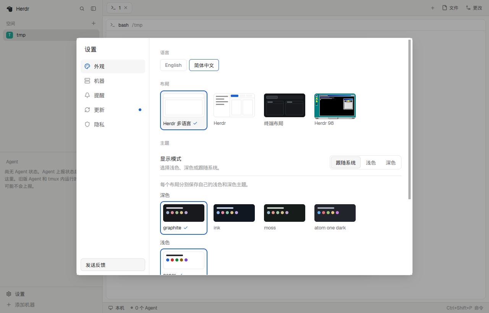

# Herdr i18n

Herdr's own window with a language menu: English, 简体中文. The spaces sidebar, the agents list, tabs, Files and Changes, the menus, the command palette, Settings and Keys change language together, without changing layout. Built by [herdr-i18n](https://github.com/Chlience/herdr-i18n) from herdr-app v0.1.13's shipped layout and mods, with only their text changed.

**What you see:** the same window as Herdr's `main` layout, region for region: the sidebar on the left with spaces by machine and the agents list, tabs as pills with a + menu, panes as cards with a header, Files and Changes on the right and the status bar at the bottom. Sizes, colors and fonts are Herdr's; the layout has no look of its own, so Settings decide it. Settings > Look starts with a Language row, one pill per language with the shown one outlined in the accent color. Text people read follows it; command names, file names, branch names and program output stay as they are.

**How it behaves:** as Herdr's `main` layout: every agent status (working, blocked, done, idle), click, drag, hover and key works the same. Clicking a language, or running `Language: <name>` from the palette, changes every panel within a moment and keeps the layout, theme and tabs. Panels reload, so what they hold only in memory, such as a folded list, can reset. The choice lasts through restarts. The translated mods open each other: the + menu, right-click menus, the palette, Settings, Keys, Welcome and What's new opened from inside the layout follow the language.

**Built from:** `layouts/herdr-i18n.json` is Herdr's `main.json` with each mod renamed to its copy and `terminal_menu` set to `i18n-menu`. The mods are `i18n-workspace-chrome`, `i18n-workspace-status`, `i18n-spaces`, `i18n-agents`, `i18n-tabs`, `i18n-pane`, `i18n-files`, `i18n-changes`, `i18n-new-menu`, `i18n-menu`, `i18n-machine-add`, `i18n-worktree`, `i18n-picker`, `i18n-prompt`, `i18n-confirm`, `i18n-help`, `i18n-peek`, `i18n-settings`, `i18n-palette`, `i18n-welcome`, `i18n-feedback`, `i18n-whatsnew`. Each has one folder per language, which is the shipped mod or app screen of that name with its display strings replaced. Its `main.js` is one line naming the language folder to show, and the language menu rewrites that line in every mod, which reloads them. `api.js` re-exports `herdr`, points `openOverlay`, `run("mod.open")` and `run("app.settings" | "app.palette" | "app.help" | "app.welcome" | "app.feedback" | "app.whats_new")` at the copies, and holds the language menu's code. `keys.json` (Linux and Windows) and `keys.macos.json` (macOS) hold a `layout:herdr-i18n` section that sends the Settings, palette, Keys and picker shortcuts to the copies while this layout shows. The only files it writes are those `main.js`. Nothing reaches the network, runs programs or reads files beyond what Herdr's own mods do.

**Watch out:** the copies are of herdr-app v0.1.13; Herdr's shipped mods update with the app but these don't, so install the build that matches your Herdr version. A layout is the only way to reach the shipped mods' text, so other layouts stay in English. What Herdr opens or draws by fixed name stays in English too: the close confirmations, the rename box, the peek bar, notifications, native menus and errors; Welcome on first start, What's new after an update, and Settings from an update notice. The body of What's new is the English release notes. Merging `keys.json` into yours makes it personal: Herdr stops adding new default shortcuts to it.

**Done when:** `herdr-app check` passes for every `i18n-*` mod; `layout.switch {"name":"herdr-i18n"}` shows the window; clicking each language in Settings > Look changes the sidebar, tabs and the open Settings without changing `herdr-app status`'s layout; the language is still chosen after restarting the app; the + menu, a tab's right-click menu, the palette and Keys all open in that language.
