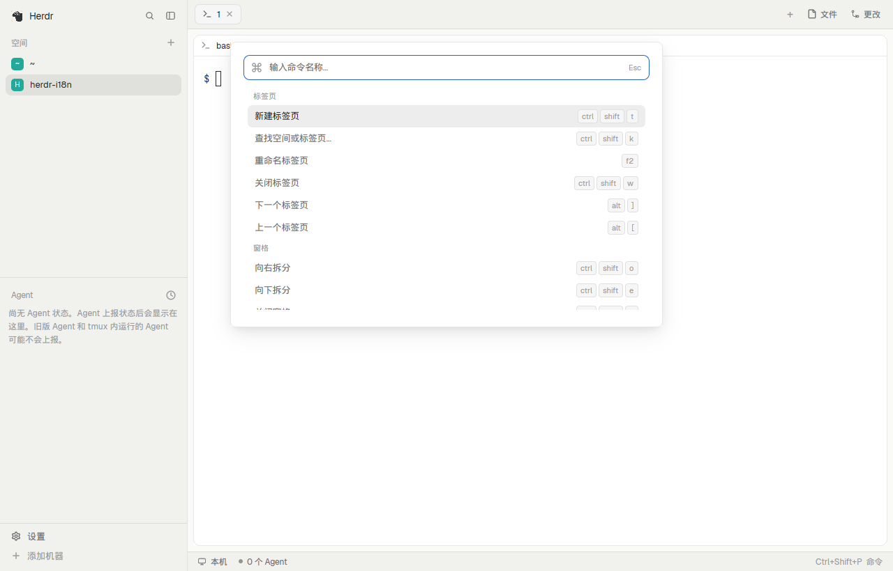

# Herdr 简体中文

Herdr's own window, in 简体中文: the spaces sidebar, the agents list, tabs, pane headers, Files and Changes, the menus, the command palette, Settings, Keys, Welcome and What's new. Built by [herdr-i18n](https://github.com/Chlience/herdr-i18n) from herdr-app v0.1.13's shipped layout and mods, with only their text changed.

**What you see:** the same window as Herdr's `main` layout, region for region: the sidebar on the left with spaces by machine and the agents list, tabs as pills with a + menu, panes as cards with a header, Files and Changes on the right and the status bar at the bottom. Sizes, colors and fonts are Herdr's; the layout has no look of its own, so Settings decide it. Text people read is in 简体中文; command names, file names, branch names and program output stay as they are.

**How it behaves:** exactly as Herdr's `main` layout: every agent status (working, blocked, done, idle), click, drag, hover and key works the same. The translated mods open each other: the + menu, menus, dialogs, the palette, Settings, Keys and Welcome opened from inside the layout are the translated ones.

**Built from:** `layouts/zh-cn.json` is Herdr's `main.json` with each mod renamed to its translated copy and `terminal_menu` set to `zh-cn-menu`. The mods are `zh-cn-workspace-chrome`, `zh-cn-workspace-status`, `zh-cn-spaces`, `zh-cn-agents`, `zh-cn-tabs`, `zh-cn-pane`, `zh-cn-files`, `zh-cn-changes`, `zh-cn-new-menu`, `zh-cn-menu`, `zh-cn-machine-add`, `zh-cn-worktree`, `zh-cn-picker`, `zh-cn-prompt`, `zh-cn-confirm`, `zh-cn-help`, `zh-cn-peek`, `zh-cn-settings`, `zh-cn-palette`, `zh-cn-welcome`, `zh-cn-feedback`, `zh-cn-whatsnew`: each is the shipped mod or app screen of the same name with its display strings replaced, plus an `api.js` that re-exports `herdr` and points `openOverlay`, `run("mod.open")` and `run("app.settings" | "app.palette" | "app.help" | "app.welcome" | "app.feedback" | "app.whats_new")` at the translated copies. `keys.json` (Linux and Windows) and `keys.macos.json` (macOS) hold a `layout:zh-cn` section that sends the Settings, palette, Keys and picker shortcuts to the translated screens while this layout shows. Nothing reaches the network, runs programs or reads files beyond what Herdr's own mods do.

**Watch out:** the copies are of herdr-app v0.1.13; Herdr's shipped mods update with the app but these don't, so install the build that matches your Herdr version. Screens Herdr opens by itself (Welcome on first start, What's new after an update, Settings from an update notice) and text drawn by the app itself (toasts, native menus, errors) stay in English. Merging `keys.json` into yours makes it personal: Herdr stops adding new default shortcuts to it.

**Done when:** `herdr-app check` passes for every `zh-cn-*` mod; `layout.switch {"name":"zh-cn"}` shows the window in 简体中文; the + menu, a tab's right-click menu, the palette (from its shortcut and from the status bar), Settings (from the sidebar and its shortcut) and Keys all open in 简体中文.
